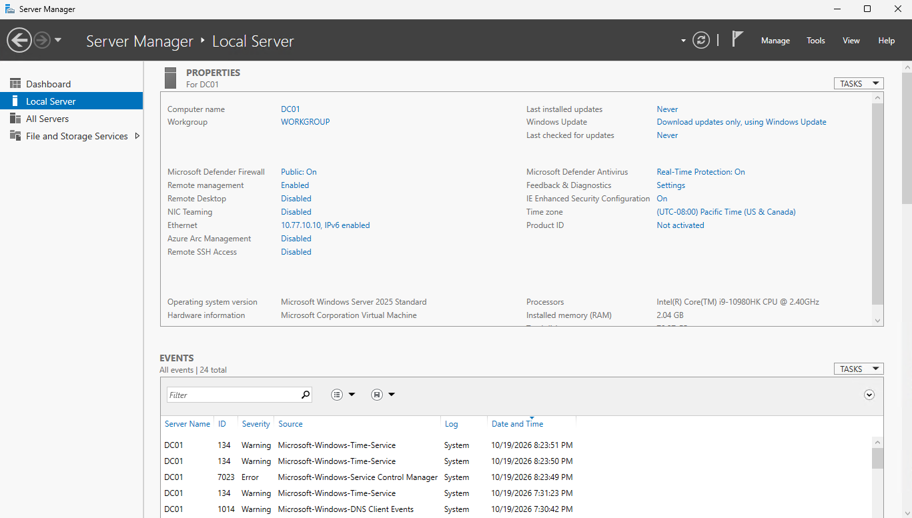
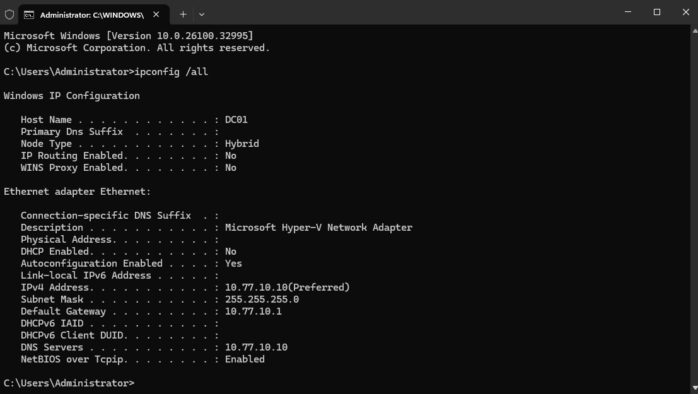

# Objective

Deploy and configure the first Windows Server virtual machine for the Nexora Technologies Active Directory environment.

# Configuration

- Hypervisor: Microsoft Hyper-V
- Operating System: Windows Server 2025 Standard Evaluation (Desktop Experience)
- Server name: DC01
- Virtual processors: 2
- Startup memory: 4 GB
- Virtual hard disk: 80 GB
- Virtual switch: Nexora-Internal
- IPv4 address: 10.77.10.10
- Subnet mask: 255.255.255.0
- Default gateway: 10.77.10.1
- DNS server: 10.77.10.10

# Implementation

1. Created an internal virtual switch using Hyper-V.
2. Configured the host virtual network adapter with the IP address 10.77.10.1.
3. Created the DC01 virtual machine and installed Windows Server 2025.
4. Renamed the server to DC01.
5. Assigned a static IPv4 address and configured DNS settings.
6. Verified the network configuration using ipconfig/all.
7. Successfully tested connectivity to the Hyper-V host using ping 10.77.10.1

# Screenshots

**DC01 - Windows Server Configuration**

**DC01 - Network Configuration**

# Outcome

Successfully deployed DC01 and verified communication between the Windows Server virtual machine and it's Hyper-V host. The server is prepared for Active Directory Domain Services installation and domain controller promotion.
