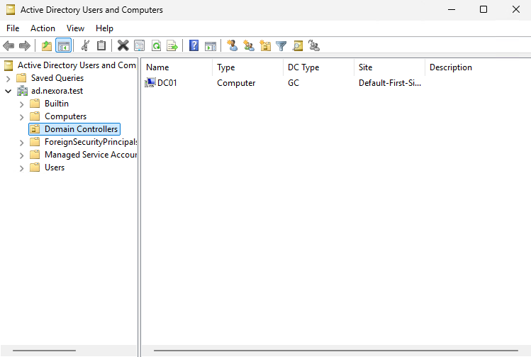
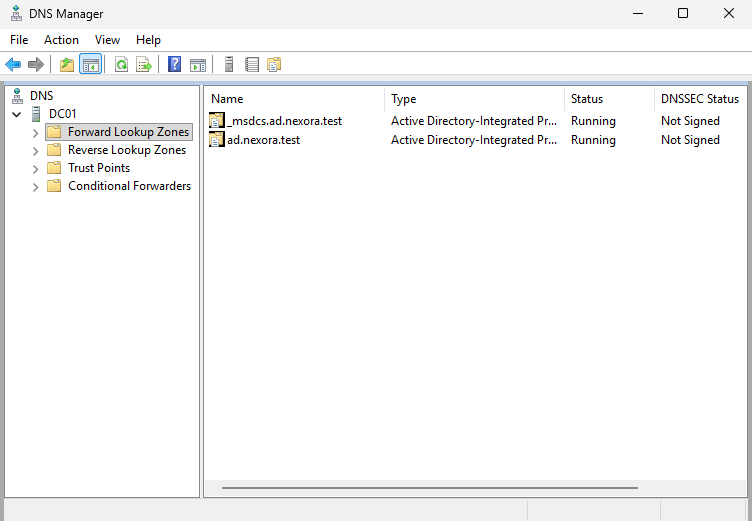
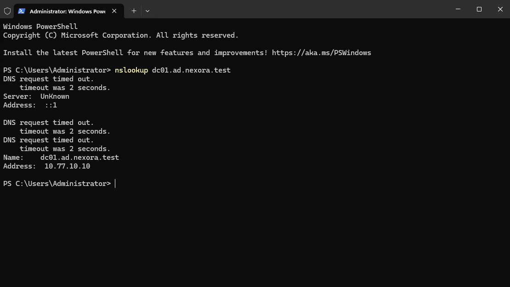

# Objective

Deploy Active Directory Domain Services (AD DS) on DC01 and establish a new Active Directory forest and domain for the fictional company Nexora Technologies.

# Environment

| Component | Configuration |
| :--- | :--- |
| Server Name | DC01 |
| Domain Name | ad.nexora.test |
| NetBIOS Name | NEXORA |
| Domain Controller IP | 10.77.10.10 |
| DNS Server | DC01 (10.77.10.10) |

# Implementation

### I. Install Active Directory Domain Services

1. Opened Server Manager and selected Manage -> Add Roles and Features
2. Selected Role-based or feature-based installation.
3. Selected DC01 as the destination server.
4. Installed the Active Directory Domain Services role and its required features.

### II. Promote DC01 to a Domain Controller

1. Opened the AD DS Configuration Wizard.
2. Selected Add a new forest.
3. Entered ad.nexora.test as the root domain name.
4. Configured Windows Server 2025 forest and domain functional levels.
5. Enabled DNS Server and Global Catalog.
6. Configured a Directory Services Restore Mode (DSRM) password.
7. Set the NetBIOS domain name to NEXORA.
8. Kept the default database, log, and SYSVOL paths.
9. Completed the prerequisite checks and promoted DC01 to a domain controller.

### III. Verify Active Directory

Opened Active Directory Users and Computers and verified that:
- The ad.nexora.test domain exists.
- DC01 appears in the Domain Controllers organizational unit.

### IV. Verify DNS Configuration

Opened DNS Manager and confirmed the following forward lookup zones:
- ad.nexora.test
- _msdcs.ad.nexora.test

### V. Test

Executed in command prompt: nslookup dc01.ad.nexora.test

The DNS server successfully resolved dc01.ad.nexora.test to 10.77.10.10
The query displayed Server: UnKnown and Address: ::1, indicating that the DNS server was queried through IPv6 loopback address without a corresponding reverse lookup name. This did not prevent successful hostname resolution.

# Outcome

Successfully deployed the first Active Directory domain controller for Nexora Technologies.
The new ad.nexora.test domain is operational, DC01 is visible in Active Directory Users and Computers, and DNS hostname resolution was verified.
