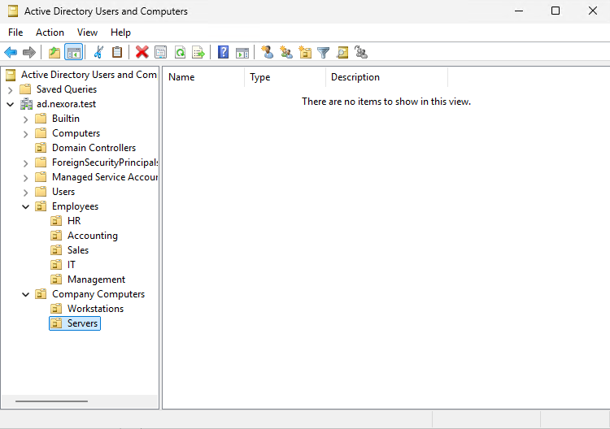

# Objective

Create an organized Active Directory structure for Nexora Technologies using Organizational Units (OUs) to separate employees by department and computers by their roles.
This structure will support centralized administration, Group Policy management, and future access-control configurations.

# Environment

| Component | Configuration |
| :--- | :--- |
| Domain | ad.nexora.test |
| Domain Controller | DC01 |
| Operating System | Windows Server 2025 Standard Evaluation |
| Management Tool | Active Directory Users and Computers (ADUC)

# Organizational Unit Structure

The Domain Controllers OU is the default organizational unit created by Active Directory and was not manually created or modified during this lab.

# Implementation

# I. Create the Employees OU
  1. Opened Server Manager -> Tools -> Active Directory Users and Computers
  2. Expanded the ad.nexora.test domain.
  3. Right-clicked the domain and selected New -> Organizational Unit.
  4. Created an OU named Employees.
  5. Enabled protection against accidental deletion.

# II. Create Department OUs
Created the following child organizational units under Employees:
- HR
- Accounting
- Sales
- IT
- Management

Each OU represents a department within Nexora Technologies organization.
These OUs will be used to organize employee accounts and apply department-specific Group Policy settings.

# III. Create the Company Computers OU
Created a top-level OU named Company Computers. Under this OU, created two child OUs:
- Workstations - for domain-joined employee computers, such as CLIENT01 and CLIENT02.
- Servers - for future member servers, such as FILE01.

DC01 remains in the default Domain Controllers OU because domain controllers require separate Group Policy and security management.

# Why Organizational Units Matter

Organizational Units allow administrators to organize users, computers, and other Active Directory objects into logical groups.

They also support:
- Group Policy: Apply settings to specific departments or computer categories.
- Administrative delegation: Give designated administrators control over specific OUs.
- Centralized management: Make user accounts and computers easier to locate and maintain.

OUs organize objects and define management or policy scope; they do not automatically grant file or network permissions. Security groups will be used for that purpose.

# Outcome

Successfully created and verified the planned Active Directory Organizational Unit structure for Nexora Tehcnologies.

The environment is now prepared for employee account creation, security group management, and future Group Policy configuration.
