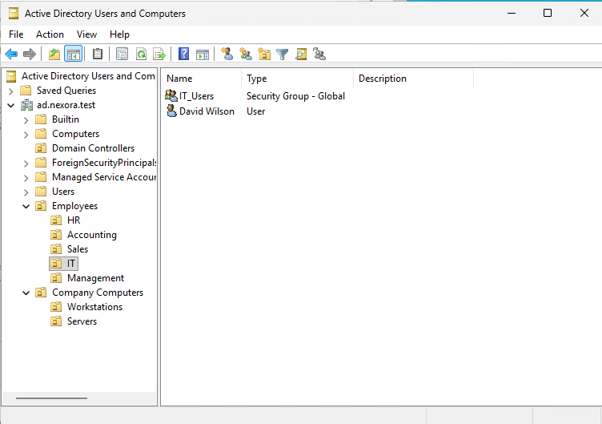
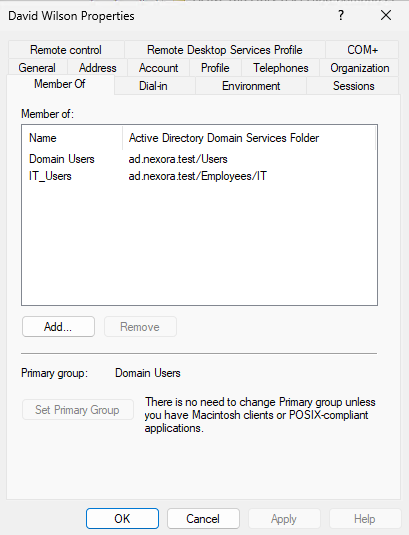

# Objective

Create and manage Active Directory user accounts and departmental security groups.
The goal of this lab is to practice identity management, account configuration, group membership, and role-based access management concepts.

| Component | Configuration |
| :--- | :--- |
| Domain | ad.nexora.test |
| Domain Controller | DC01 |
| Operating System | Windows Server 2025 Standard Evaluation |
| Management Tool | Active Directory Users and Computers (ADUC) |
| Employee Accounts | 5 |
| Security Groups | 5 |

# Employee Accounts

Created 5 fictional employees in their respective departmental Organizational Units.

| Department | Employee | Username | Security Group |
| :--- | :--- | :--- | :--- |
| Sales | John Smith | jsmith | Sales_Users |
| HR | Sarah Johnson | sjohnson | HR_Users |
| Accounting | Michael Brown | mbrown | Accounting_Users |
| IT | David Wilson | dwilson | IT_Users |
| Management | Emily Davis | edavis | Management_Users |

# Implementation

# I. Create Active Directory User Accounts

  1. Opened Server Manager -> Tools -> Active Directory Users and Computers.
  2. Navigated to ad.nexora.test -> Employees.
  3. Selected the appropriate departmental OU.
  4. Created a new user account for each employee.
  5. Assigned each account a unique username and temporary password.
  6. Enabled User must change password at next logon.
  7. Unchecked User cannot change password, Password never expires, and Account is disabled.

# II. Create Departmental Security Groups

Created the following groups inside their respective department OUs:
- Sales_Users
- HR_Users
- Accounting_Users
- IT_Users
- Management_Users

Each group was configured with:
- Group scope = Global
- Group type = Security

Global security groups allows administrators to organize users from the same domain and manage their access through group membership.

# III. Assign Employees to Security Groups

Added each employee to their corresponding departmental security group.

For example:
- John Smith (jsmith) was added to Sales_Users.
- Sarah Johnson (sjohnson) was added to HR_Users.

The same process was repeated for Accounting, IT, and Management.

# IV. Verify User Accounts and Group Membership

Opened each employee's properties in Active Directory Users and Computers and checked the Member Of tab.
Verified that all five employees belong to their assigned departmental security groups.

**User Accounts and Security Groups**

**Group Membership Verification**

# Security Considerations

- Each employee has a unique Active Directory account.
- Accounts are organized into department-specific OUs.
- Users are assigned to departmental security groups instead of being individually granted resource permissions.
- Temporary passwords must be changed at first sign-in.
- Standard employee accounts were not granted Domain Admin privileges.
- Group membership alone does not automatically grant access to resources. Permissions will be configured in a future file server lab.

# Outcome

Successfully created 5 Active Directory user accounts and 5 Global Security Groups.
Verified that each employee is located in the correct Organization Unit and belongs to the appropriate security group.

The environment is now prepared for workstation domain joining and future file-sharing permission tests.
