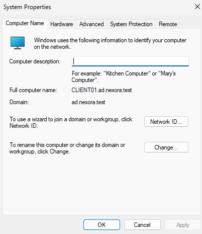
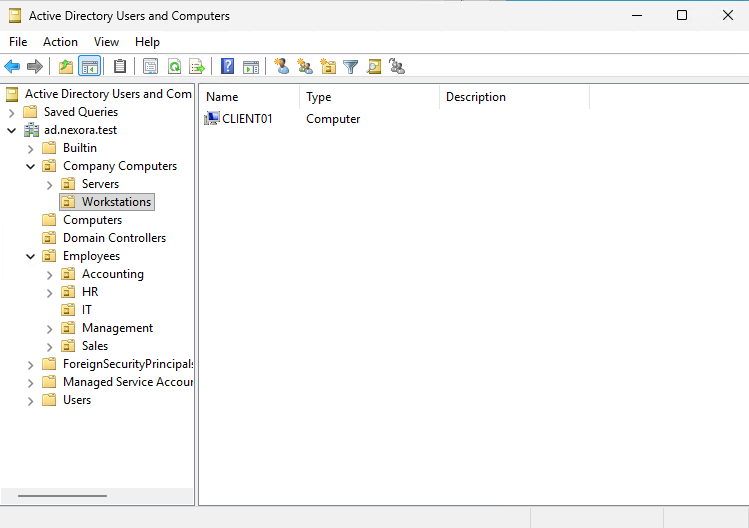
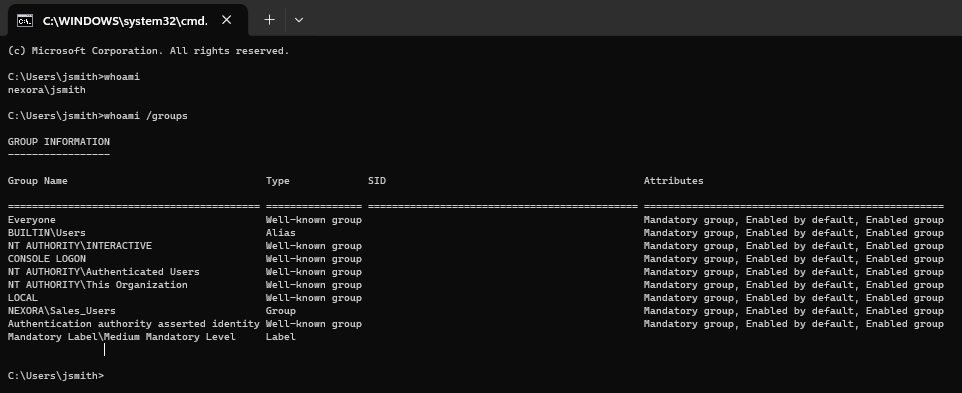

# Objective

Deploy a Windows 11 workstation, join it to the ad.nexora.test Active Directory domain, and verify that a domain user can successfully sign in.
This lab also demonstrates DNS configuration, computer account management, security group verification.

# Environment

| Component | Configuration |
| :--- | :--- |
| Domain | ad.nexora.test |
| Domain Controller | DC01 |
| Domain Controller IP | 10.77.10.10 |
| Client Computer | CLIENT01 |
| Operating System | Windows 11 Pro |
| Virtual Processors | 2 |
| Startup Memory | 8 GB |
| Virtual Hard Disk | 80 GB |
| Virtual Switch | Nexora-Internal |
| CLIENT01 IP | 10.77.10.21 |
| Default Gateway | 10.77.10.1 |
| Preferred DNS | 10.77.10.10 |

# Implementation

# I. Create the CLIENT01 Virtual Machine

Using Microsoft Hyper-V:
  1. Created a Generation 2 virtual machine named CLIENT01.
  2. Allocated 8 GB of startup memory and 2 virtual processors.
  3. Created an 80 GB virtual hard disk.
  4. Connected CLIENT01 to the Nexora-Internal virtual switch.
  5. Enabled Secure Boot and the virtual Trusted Platform Module (TPM).
  6. Installed Windows 11 Pro.
  7. Created a local administrator account for initial setup.

# II. Configure Network Settings

Assigned the following static IPv4 configuration:

| Setting | Value |
| :--- | :--- |
| IP Address | 10.77.10.21 |
| Subnet Mask | 255.255.255.0 |
| Default Gateway | 10.77.10.1 |
| DNS Server | 10.77.10.10 |

Configured CLIENT01 to use DC01 for DNS resolution.

# III. Verify Network Connectivity

Executed the following commands in command prompt:
  - ipconfig /all
  - ping 10.77.10.10
  - nslookup dc01.ad.nexora.test

Verified that:
  - CLIENT01 had the correct static IPv4 configuration.
  - CLIENT01 could communicate with DC01.
  - DNS successfully resolved dc01.ad.nexora.test to 10.77.10.10.

# IV. Join CLIENT01 to Active Directory

  1. Opened System Properties -> Computer Name -> Change.
  2. Selected Domain.
  3. Entered ad.nexora.test.
  4. Provided authorized domain administrator credentials.
  5. Successfully joined the domain.
  6. Restarted CLIENT01.

Verified the computer's domain membership in System Properties.

# V. Organize CLIENT01 in Active Directory

  1. On DC01, opened Active Directory Users and Computers.
  2. Located CLIENT01 in the default Computers container and moved it to: ad.nexora.test -> Company Computers -> Workstations.

This allows workstation-specific Group Policy settings to be applied in future labs.

# VI. Verify Domain Authentication

Signed in to CLIENT01 using the fictional Sales employee account: (NEXORA\jsmith)
Executed the following commands in command prompt:
  - whoami
  - whoami /groups

# Outcome

Successfully deployed Windows 11 Pro, joined CLIENT01 to the ad.nexora.test domain, and verified domain authentication.
Confirmed that John Smith (NEXORA\jsmith) could sign in using his domain account and that his Sales security group membership was recognized.
