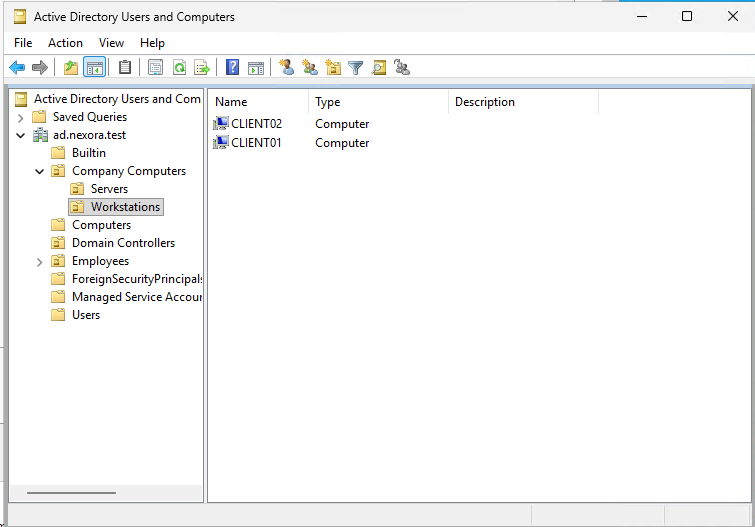
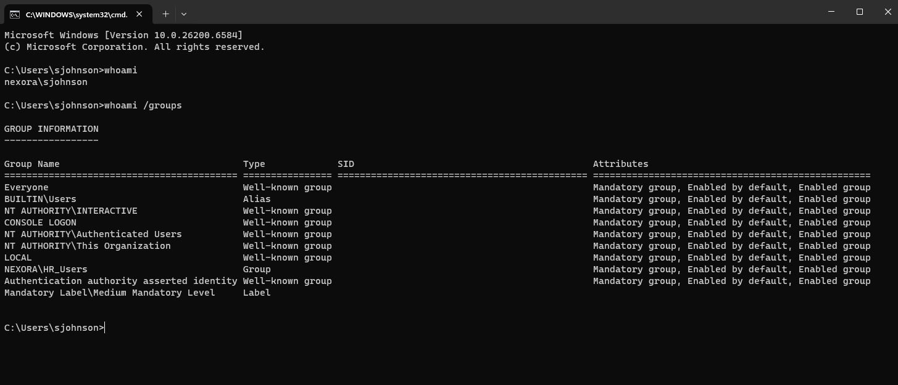

# Objective

Deploy a second Windows 11 Pro workstation, join it to the ad.nexora.test domain, and verify centralized user authentication.
This lab also covers troubleshooting broken Active Directory computer trust relationships.

# Environment

| Component | Configuration |
| :--- | :--- |
| Domain | ad.nexora.test |
| Domain Controller | DC01 |
| Virtual Switch | Nexora-Internal |
| CLIENT01 IP Address | 10.77.10.21 |
| CLIENT02 IP Address | 10.77.10.22 |
| Operating System | Windows 11 Pro |
| CLIENT02 Memory | 8 GB |
| CLIENT02 Processors | 2 |
| CLIENT02 Storage | 80 GB |
| CLIENT02 DNS Server | 10.77.10.10 |

# Implementation

# I. Deploy CLIENT02
Using Microsoft Hyper-V:

1. Created a Generation 2 virtual machine named CLIENT02.
2. Allocated 8 GB of startup memory and 2 virtual processors.
3. Created an 80 GB virtual hard disk.
4. Connected the machine to Nexora-Internal virtual switch.
5. Enabled Secure Boot and virtual TPM.
6. Installed Windows 11 Pro.
7. Created a local administrator account for initial configuration.

# II. Configure Networking
Configured CLIENT02 with the following static IPv4 settings:

| Setting | Value |
| :--- | :--- |
| IP Address | 10.77.10.22 |
| Subnet Mask | 255.255.255.0 |
| Default Gateway | 10.77.10.1 |
| Preferred DNS | 10.77.10.10 |

Verified network connectivity using the following commands in command prompt:
- ipconfig /all
- ping 10.77.10.10
- nslookup dc01.ad.nexora.test

All three network tests passed.

# III. Join CLIENT02 to Active Directory

1. Opened System Properties -> Computer Name -> Change.
2. Configured the computer name as CLIENT02.
3. Joined the ad.nexora.test domain using authorized administrator credentials.
4. Restarted the workstation.
5. Verified domain membership.

# IV. Organize Workstation in Active Directory
Used Active Directory Users and Computers to organize both workstations under:

ad.nexora.test -> Company Computers -> Workstations

# Troubleshooting - Broken Domain Trust Relationships

# Problem
During CLIENT02 deployment, the two workstations appeared to have conflicting computer names. Further testing showed Active Directory secure channels on both workstations.

# Diagnosis
Used the following commands to investigate in PowerShell (Admin):
- hostname
- nltest /dsgetdc:ad.nexora.test
- Test-ComputerSecureChannel

# Findings
- CLIENT02 successfully located the domain controller.
- CLIENT02 returned False from Test-ComputerSecureChannel.
- CLIENT01 also returned False
- Searching Active Directory did not locate CLIENT01's computer account.

These results indicated computer trust problems rather than a general inability to locate the domain controller.

# Resolution - CLIENT02

Temporarily disconnected CLIENT02 from the Hyper-V virtual switch while checking its computer name and domain membership.
Confirmed that the Windows computer name was CLIENT02 and the domain was ad.nexora.test.

Reconnected CLIENT02 and repaired its domain secure channel using PowerShell with authorized domain administrator credentials.
- Test-ComputerSecureChannel -Repair -Credential (Get-Credential)

Verified the repair with:
- Test-ComputerSecureChannel

Result: True

# Resolution - CLIENT01

Because CLIENT01's computer account could not be found in Active Directory:
1. Signed in using the local administrator account.
2. Changed domain membership to WORKGROUP.
3. Restarted the workstation.
4. Rejoined ad.nexora.test domain.
5. Restarted and verified its secure channel.

Result: True

CLIENT01's computer account appeared in Active Directory again and was moved to the Workstations OU.

# Verify Domain Authentication
Signed in to CLIENT02 using the fictional HR employee (NEXORA\sjohnson)

# Outcome

Successfully deployed and authenticated a second Windows 11 domain workstation.
Recovered broken domain trust relationships on CLIENT01 and CLIENT02 without reinstalling either operating system.

Both computers have valid secure channels with the domain controller, and domain users can authenticate using their respective departmental accounts.
