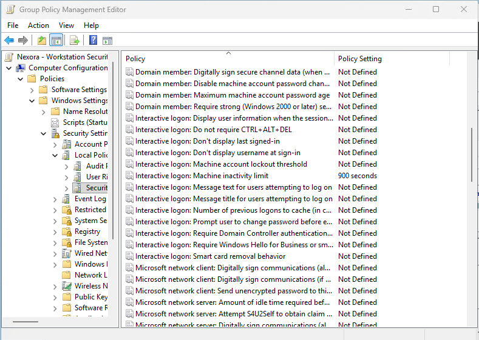
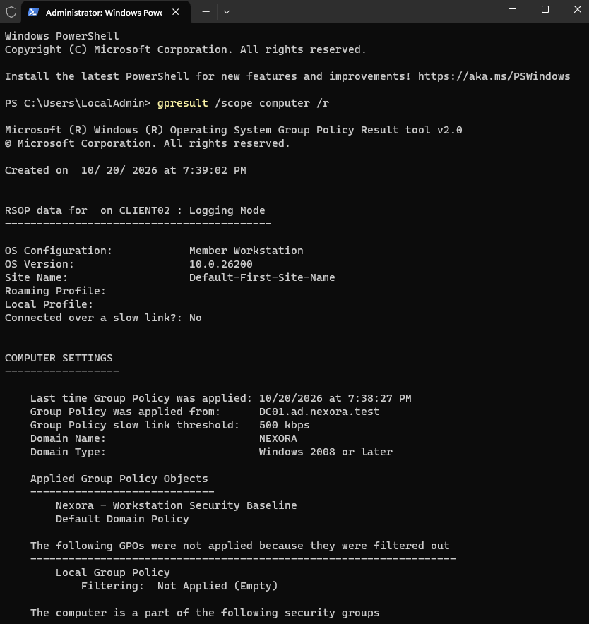
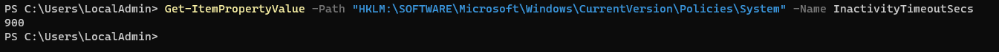

# Objective
Configure and test a Group Policy Object (GPO) that automatically locks inactive Windows workstations after 15 minutes.

The goal is to practice centralized security management using Active Directory Group Policy and verify that the settings apply correctly to multiple domain-joined computers.

# Environment
| Component | Configuration |
| :--- | :--- |
| Domain | ad.nexora.test |
| Domain Controller | DC01 |
| Operating System | Windows Server 2025 |
| Client Workstations | CLIENT01, CLIENT02 |
| Client Operating System | Windows 11 Pro |
| Target OU | Company Computers -> Workstations |
| GPO Name | Nexora - Workstation Security Baseline |
| Inactivity Timeout | 900 seconds (15 minutes) |

# Implementation
# I. Create and Link the Group Policy Object
1. Opened Server Manager -> Tools -> Group Policy Management on DC01.
2. Navigated to ad.nexora.test -> Company Computers > Workstations.
3. Selected Create a GPO in this domain, and Link it here.
4. Created the GPO named Nexora - Workstation Security Baseline.
5. Linked the GPO to the Workstations OU.

This allows the policy to target CLIENT01 and CLIENT02 without targeting the domain controller.

# II. Configure the Inactivity Timeout
Opened the Group Policy Management Editor and navigated to:

Computer Configuration -> Policies -> Window Settings -> Security Settings -> Local Policies -> Security Options

Enabled Define this policy setting and applied the configuration.

# III. Apply Group Policy to Workstations
On CLIENT01 and CLIENT02, executed this on command prompt (Admin):
- gpupdate /force
Restarted the workstations to ensure the security setting was applied.

# IV. Verify Group Policy Application

Confirmed that Nexora - Workstation Security Baseline appeared under Applied Group Policy Objects

# V. Verify the Configured Registry Value

This confirms that both computers had the configured 15-minute inactivity timeout.

# VI. Test Automatic Workstation Locking
Signed in to CLIENT02 using the fictional HR employee account (NEXORA\sjohnson)

Left the Windows desktop idle without interacting with the virtual machine for approximately 15 minutes.
Observed result: Windows automatically locked the user session and required authentication to regain access.

This confirms that the inactivity timeout worked in practice, not just in the Group Policy configuration.

# Security Benefits
The workstation inactivity policy helps Nexora Technologies:
- Reduce the risk of unauthorized access to unattended workstations.
- Apply consistent security settings across domain computers.
- Manage workstations configurations centrally.
- Extend security settings to future computers added to the Workstations OU.

# Outcome
Successfully created and linked a workstation security GPO. Both CLIENT01 and CLIENT02 received the configured 900-sescond inactivity timeout.
CLIENT02 automatically locked its user session after approximately 15 minutes of inactivity, confirming that the security policy was functioning.
