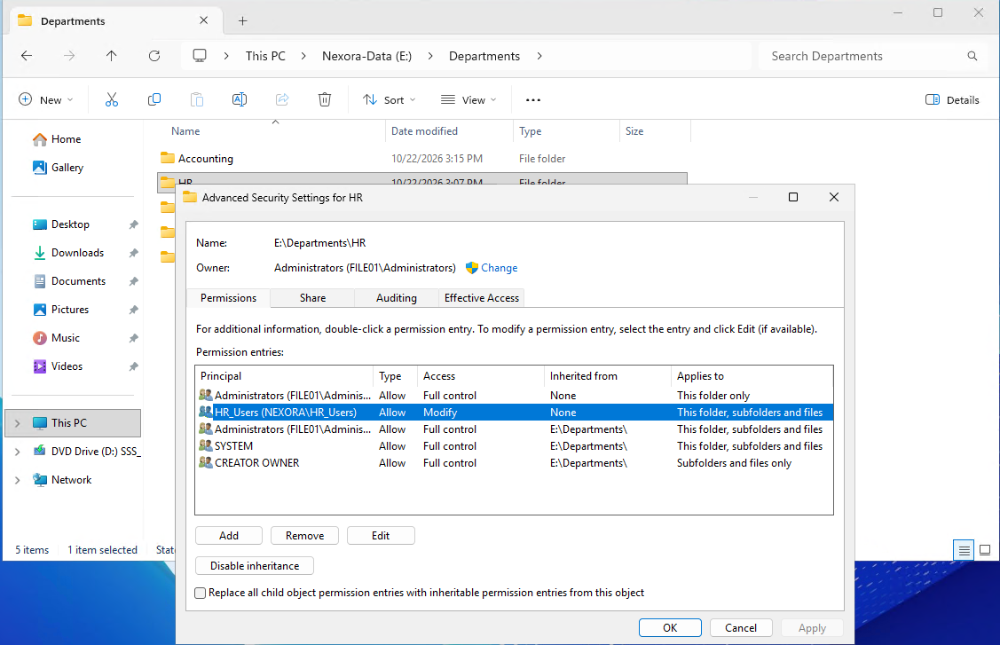
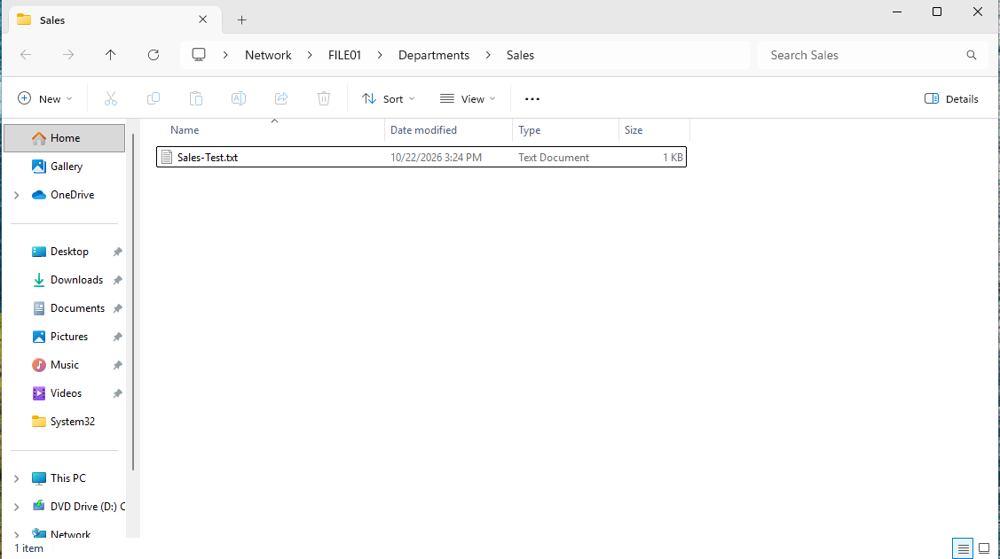
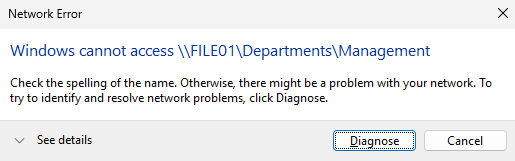

# Objective
Deploy a domain-joined Windows file server for Nexora Technologies and implement a secure department-specific access to shared resources using Active Directory security groups, SMB sharing, and NTFS permissions.

This lab demonstrates the principle of least privilege by allowing employees to access their own department's files while restricting access to other departments.

# Environment

| Component | Configuration |
| :--- | :--- |
| Domain | ad.nexora.test |
| Domain Controller | DC01 (Windows Server 2025) |
| File Server | FILE01 (Windows Server 2025) |
| File Server IP Address | 10.77.10.30 |
| Domain Workstations | CLIENT01 and CLIENT02 (Windows 11 Pro) |
| Hyper-V Network | Nexora-Internal |
| File Storage | 50 GB secondary virtual disk (E:) |
| Shared Folder | E:\Departments |
| Network Share | \\FILE01\Departments |

# I. Deploying FILE01
Created a new Windows Server 2025 virtual machine in Hyper-V to serve as the organization's dedicated file server.

Configured the virtual machine with:
- 4 GB RAM
- 2 virtual processors
- 80 GB operating system disk
- 50 GB secondary virtual disk for department files
- Nexora-Internal virtual network connection

Configured the server's static IPv4 address as 10.77.10.30, using the domain controller at 10.77.10.10 for DNS resolution.
Joined FILE01 to the ad.nexora.test domain, verified its secure channel, and moved its computer account into the Company Computers -> Servers Organizational Unit.

# II. Configuring File Storage
Initialized and prepared the secondary virtual disk, assigning it drive letter E:.

Created the following directory structure:

Separating department files from the operating system disk improves organization and makes future storage management easier.

# III. Configuring the SMB Network Share
Using Server Manager -> File and Storage Services -> Shares, created an SMB share with the following configuration:

| Setting | Value |
| :--- | :--- |
| Share name | Departments |
| Local path | E:\Departments |
| Network path | \\FILE01\Departments |
| Access-Based Enumeration | Enabled |
| Offline Caching | Disabled |
| SMB Encryption | Enabled |

Configured the SMB share permissions to allow Authenticated Users Full Control, with access to individual department folders restricted through NTFS permissions.

Removed the Everyone group from the share permissions.

Security design: SMB permissions control access at the network-share level, while NTFS permissions provide more granular protection for individual department folders. Both permission sets apply to network access.

# IV. Configuring NTFS Permissions
Configured E:\Departments so that Authenticated Users have Read & Execute permissions on the parent folder only.

This allows employees to reach the shared location without granting broad access to department subfolders.

For each department folder, configured a dedicated Active Directory security group with Modify permissions.

| Department folder | Security group | NTFS permission |
| :--- | :--- | :--- |
| HR | NEXORA\HR_Users | Modify |
| Accounting | NEXORA\Accounting_Users | Modify |
| Sales | NEXORA\Sales_Users | Modify |
| IT | NEXORA\IT_Users | Modify |
| Management | NEXORA\Management_Users | Modify |

Configured the departmental permissions to apply to the folder, its subfolders, and files.
Preserved administrative and SYSTEM access while ensuring Authenticated Users permissions did not propagate into department folders.

Using security groups rather than assigning permissions to individual users simplifies administration when employees join, leave, or change departments.

# V. Testing Authorized Access
Signed in to domain-joined Windows 11 workstations using fictional employee accounts and tested access to their assigned department folders.

For each authorized employee, verified the ability to open the folder, create a text document, and save changes.

| Employee | Username | Department | Result |
| :--- | :--- | :--- | :--- |
| Sarah Johnson | sjohnson | HR | Passed |
| Michael Brown | mbrown | Accounting | Passed |
| John Smith | jsmith | Sales | Passed |
| David Wilson | dwilson | IT | Passed |
| Emily Davis | edavis | Management | Passed |

These tests confirmed that the configured department groups could access and modify their assigned folders.

# VI. Testing Unauthorized Access
Tested attempts to open restricted department folders using accounts belonging to other departments.

| Test account | Restricted folder | Result |
| :--- | :--- | :--- |
| jsmith (Sales) | HR | Access Denied |
| jsmith (Sales) | Accounting | Access Denied |
| sjohnson (HR) | Sales | Access Denied |
| jsmith (Sales) | IT | Access Denied |
| jsmith (Sales) | Management | Access Denied |

The Windows clients displayed a "Windows cannot access" message when attempting to access the restricted folders.
The results demonstrates that the tested employees could not access department folders outside their assigned group permissions.

# VII. Security Principles Demonstrated
**Least privilege**: Employees receive only the permissions required to work with their own department's resources.
**Group-based access control**: File access is assigned through Active Directory security groups rather than individual user accounts.
**NTFS permissions inheritance**: Inheritance was reviewed to prevent broad permissions from unintentionally applying to restricted department folders.
**Access-Based Enumeration**: The share was configured to hide resources from users who lack permission to access them.
**SMB encryption**: Encryption was enabled for SMB connections to help protect data transmitted across the network.
**Authorized and unauthorized testing**: Both successful file operations and block cross-department access were tested to verify the configuration.

# Lessons Learned
This lab provided hands-on experience with:
- Deploying and joining a Windows File server to an Active Directory domain.
- Configuring separate virtual disks for organizational file storage.
- Creating and configuring SMB network shares.
- Understanding the relationship between SMB share permissions and NTFS permissions.
- Managing NTFS inheritance and permission scope.
- Using Active Directory security groups to control access to shared files.
- Validating access with standard domain user accounts.
- Applying least-privilege principles in a simulated business environment.
