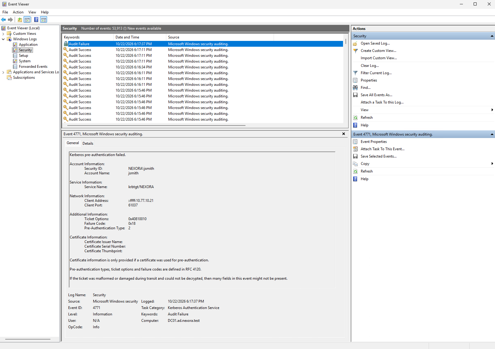
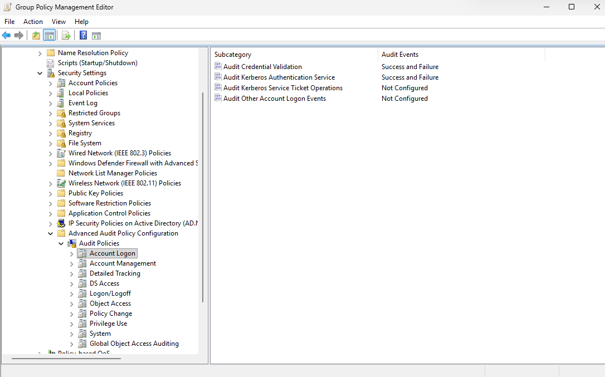
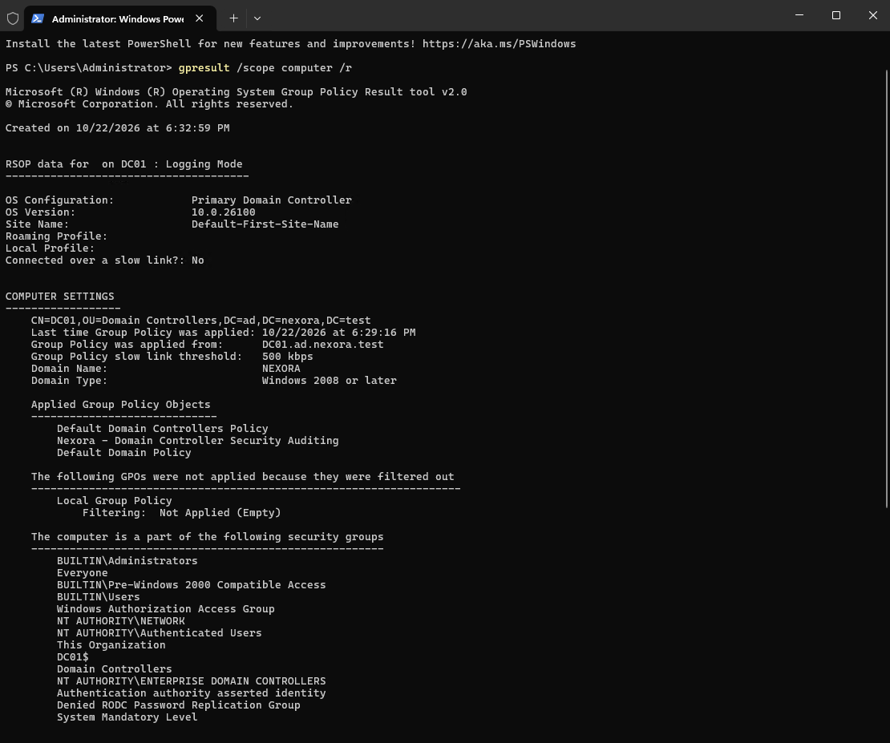
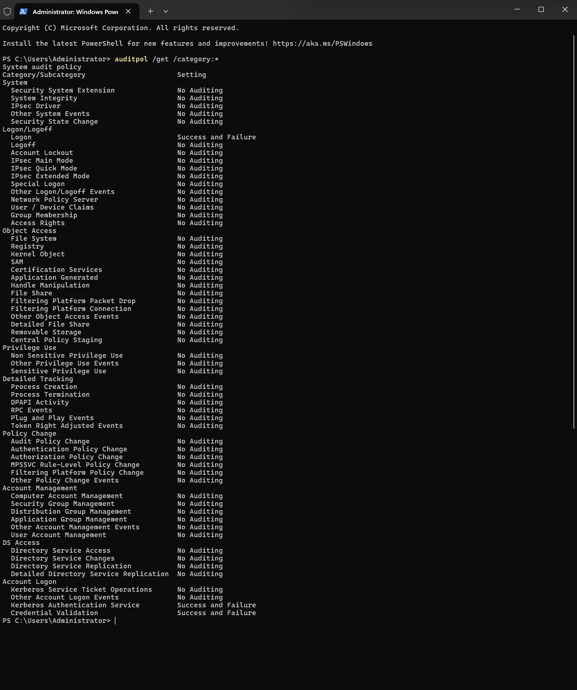

# Objective
Generate a controlled failed domain login, investigate why the authentication failure was not initially recorded, and configure security auditing to capture the event.

This lab demonstrates Windows authentication troubleshooting, Kerberos failure auditing, and centralized audit policy management through Group Policy.

# Environment
| Component | Configuration |
| :--- | :--- |
| Domain | ad.nexora.test |
| Domain Controller | DC01 (Windows Server 2025) |
| Test Workstation | CLIENT01 (Windows 11 Pro) |
| Domain Controller IP Address | 10.77.10.10 |
| Workstation IP Address | 10.77.10.21 |
| Test Account | NEXORA\jsmith |
| Network | Nexora-Internal |
| Tools | Event Viewer, PowerShell, Group Policy Management |

# I. Generating a Controlled Failed Login
On CLIENT01, attempted to sign in using the account NEXORA\jsmith with an intentionally incorrect password.
Only one failed sign-in attempt was performed to avoid unnecessarily triggering an account lockout policy.

**Expected result**: Windows rejects the incorrect password and the authentication failure is recorded in the Security event log.
**Actual result**: Windows rejected the incorrect password, but the expected failed-authentication event was not initially found.

Checked for the following events:
| Event ID | Computer | Description |
| :--- | :--- | :--- |
| 4625 | CLIENT01 | Failed Windows logon |
| 4771 | DC01 | Kerberos pre-authentication failed |
| 4776 | DC01 | NTLM credential validation |

No matching events were found for the initial test.

# II. Investigating the Audit Policy
On DC01, opened PowerShell (Administrator) and executed the command:
  - auditpol /get /category:*
    
The relevant settings were:

| Audit subcategory | Initial configuration |
| :--- | :--- |
| Credential Validation | Success |
| Kerberos Authentication Service | Success |
| Logon | Success and Failure |

Both Credential Validation and Kerberos Authentication were configured to record successful events but not failures.
This was identified as a likely reason the domain controller did not record the failed authentication attempt.

# III. Enabling Authentication Failure Auditing
On DC01, opened PowerShell (Administrator) and executed the following commands:

For Kerberos Authentication Service:
  - auditpol /set /subcategory:"Kerberos Authentication Service" /success:enable /failure:enable

For Credential Validation:
  - auditpol /set /subcategory:"Credential Validation" /success:enable /failure:enable

Verified that both settings displayed Success and Failure.

# IV. Repeating the Controlled Failed Login
After enabling failure auditing, repeated the test on CLIENT01.
1. Signed out of the current Windows session.
2. Logged in as NEXORA\jsmith.
3. Intentionally entered the incorrect password once.
4. Confirmed that Windows rejected the sign-in.
5. Opened the Event Viewer on DC01.
6. Navigated to Windows Logs -> Security
7. Filtered for Event IDs 4771 and 4776.

This time, DC01 recorded the failed authentication attempt.

# Authentication Event Results

Failure Code 0x18 corresponds to KDC_ERR_PREAUTH_FAILED, consistent with the intentionally incorrect password.
**Test Result: Passed**. The controlled failed authentication was successfully recorded after failure auditing was enabled.

# V. Configuring Centralized Auditing Through Group Policy
To manage security auditing centrally, created a Group Policy Object named:
  - Nexora - Domain Controller Security Auditing

Linked the GPO to the Domain Controllers Organizational Unit.
Configured the following policies under:

Computer Configuration -> Policies -> Windows Settings -> Security Settings -> Advanced Audit Policy Configuration -> Audit Policies

# VI. Applying and Verifying Group Policy
On DC01, opened PowerShell (Administrator) and executed this command:
  - gpupdate /force

Verified that the auditing GPO was applied:

# Verifying Effective Audit Settings

